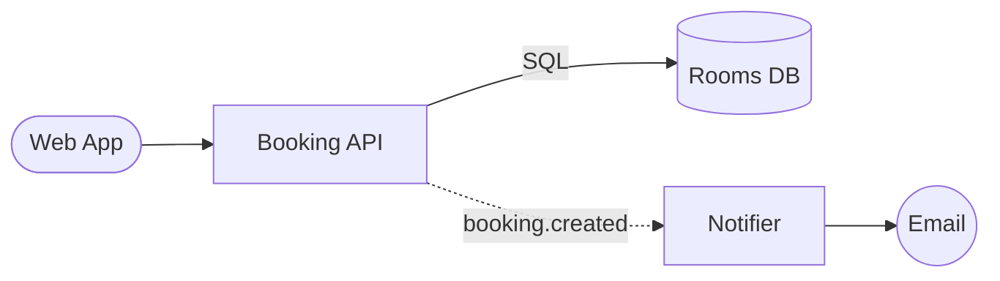

# Room Booking System

Generated from a whiteboard photo by Whiteboard2Repo (Meta Muse Spark Open).

## Invariants from the board
- The system must reject any booking that overlaps in time with an existing confirmed booking for the same room.
