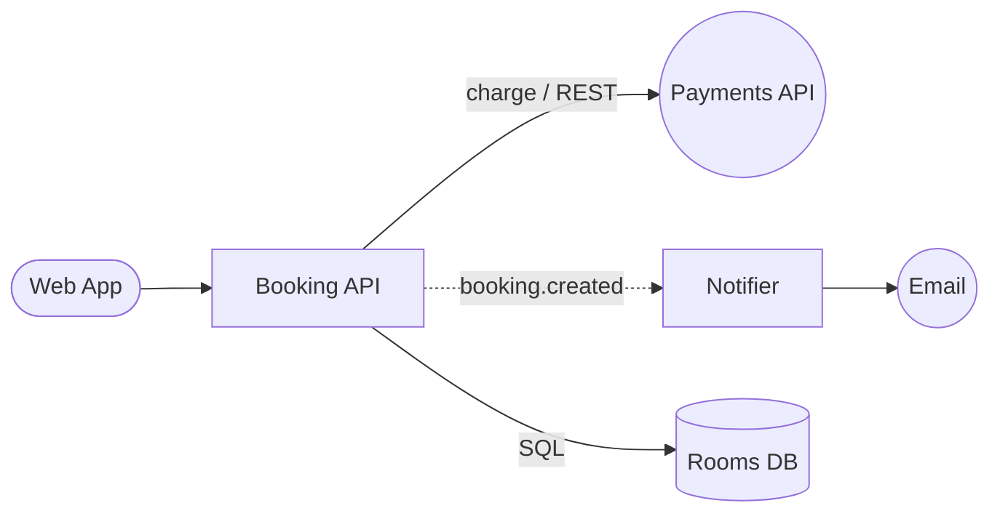

# Room Booking System

Generated from a whiteboard photo by Whiteboard2Repo (Meta Muse Spark Open).

## Invariants from the board
- The system must reject a new booking if the user already has 3 active bookings
- The system must prevent overlapping bookings for the same room - a room cannot be booked twice for the same time slot
